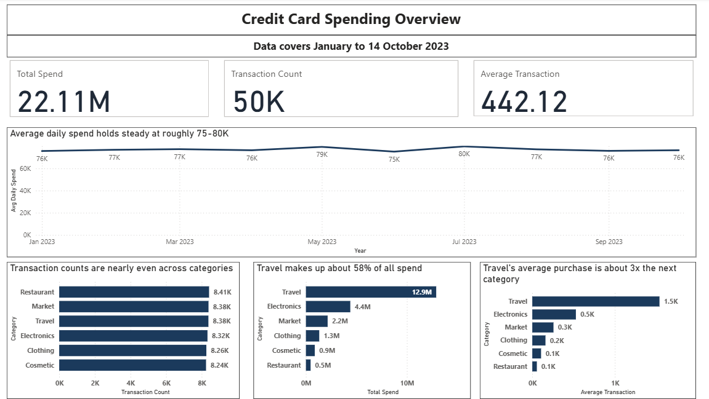

# Personal Finance Dashboard — Credit Card Spending Analysis

An interactive Power BI dashboard analyzing 50,000 credit card transactions, using the [Comprehensive Credit Card Transactions Dataset](https://www.kaggle.com/datasets/rajatsurana979/comprehensive-credit-card-transactions-dataset) (Kaggle). Built end-to-end: Power Query cleaning → DAX measures → two interactive report pages.

**Headline finding:** Travel makes up 58% of all spending — not because people travel more often, but because each travel purchase costs roughly 3x as much as purchases in any other category. Transaction *counts* are nearly identical across every category.

---

## Page 1 — Credit Card Spending Overview

| | |
|---|---|
| **Total Spend** | 22.11M |
| **Transaction Count** | 50,000 |
| **Average Transaction** | 442.12 |
| **Data range** | 1 Jan – 14 Oct 2023 |

**Average daily spend holds steady at roughly 75-80K.** The line chart uses a custom `Avg Daily Spend` measure (`Total Spend ÷ distinct days with data`) rather than raw monthly totals — this matters because the data cuts off mid-October, and a raw total would show a misleading crash in the final month purely from having fewer days. Once corrected, October sits right in line with every other month.

**Transaction counts are nearly even across categories** (8.24K–8.41K each, out of 50,000 total) — Travel is not bought more often than anything else.

**Travel makes up about 58% of all spend** (12.9M), followed by Electronics (4.4M, 20%), Market (2.2M, 10%), Clothing (1.3M, 6%), Cosmetic (0.9M, 4%), and Restaurant (0.5M, 2%).

**Travel's average purchase (~1.5K) is about 3x the next highest category (Electronics, ~0.5K).**

Put together: with an equal number of transactions but a far higher average ticket, Travel drives the majority of total spend on ticket size alone, not frequency.

## Page 2 — Who's Spending?

**Spend is close to even by gender:** F 10.1M (46%), M 9.8M (44%), and 2.2M (10%) with no gender recorded. Rather than drop that 10%, it was explicitly labeled `Unknown` and kept visible as its own category — dropping it would have understated total spend across every other chart.

**Total spend by age reflects group size, not spending behavior.** At face value, the age chart looks like spend rises with age (Under 25 lowest at 3.09M, 65+ highest at 3.87M). But dividing spend by distinct customers per group tells a different story:

| Age group | Customers | Total Spend | Spend per Customer |
|---|---|---|---|
| Under 25 | 7,045 | 3.09M | **$438** |
| 25–34 | 8,571 | 3.77M | $440 |
| 35–44 | 8,519 | 3.73M | $438 |
| 45–54 | 8,517 | 3.84M | $451 |
| 55–64 | 8,639 | 3.80M | $440 |
| 65+ | 8,709 | 3.87M | $445 |

Per-customer spend is flat — within a $13 band across every group. Under 25's lower *total* is fully explained by having fewer customers in that segment (7,045 vs. 8,500–8,700 elsewhere), not by younger customers individually spending less. This is a good example of why a raw total-by-group chart can be misleading without checking the group sizes behind it.

A **Category slicer** lets you filter both pages interactively by spending category.

## Data Notes & Limitations

- 50,000 rows, 9 original columns. `Gender` was ~10% missing and labeled `Unknown` rather than dropped.
- All transaction amounts are positive ($5.01–$2,999.88) — no refunds to account for.
- Several signals suggest this dataset is **synthetic** rather than real customer data: transaction counts are nearly uniform across categories (8.24K–8.41K, an unusually even spread for real behavior), per-customer spend is flat across every age group, merchant names follow a generic "Surname + Plc/Ltd/LLC" pattern, and customer count matches transaction count exactly — meaning every customer has exactly one transaction. Worth being upfront about this if asked in an interview.
- No hypothesis testing was run on the small differences noted above (e.g. the $13 spread in per-customer spend by age) — they're described as roughly flat rather than claimed as statistically significant.

## Tools

Power BI Desktop, Power Query (M), DAX.

## How to Open

Download `personal_finance_dashboard.pbix` and open it in Power BI Desktop (free). The dataset CSV isn't included — download it from the Kaggle link above and point Power Query at it if you want to refresh the data yourself (Home → Transform Data → Data Source Settings).
